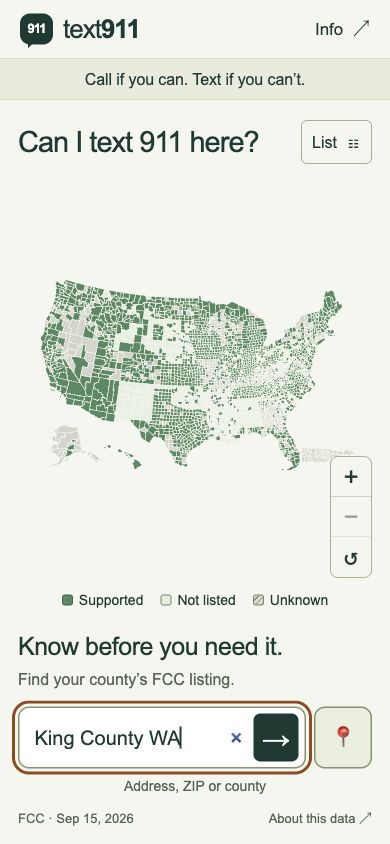

# Text911

**Can I text 911 here?** A phone-first map and lookup built from the official FCC Text-to-911 registry.

[Open the app](https://reza2kn-text911.hf.space) · [Hugging Face Space](https://huggingface.co/spaces/Reza2kn/Text911) · [Source](https://github.com/Reza2kn/Text911) · [Accessibility audit](reports/accessibility.md) · [Ten county checks](reports/county-spot-checks.md)

The map stays above a large search field and a 📍 location button. County details, guidance and sources open on demand. The main screen fits one phone viewport.



## What it does

- Search a U.S. street address, ZIP area or county.
- Find your county with device location, after browser permission.
- Show Supported, Not listed or Unknown with source dates and FCC row references.
- Browse an accessible county list without using the map.
- Refresh the FCC snapshot with a standard-library Python script.

**Call if you can, text if you can’t.** This app shows registry evidence and cannot contact emergency services or verify delivery.

## Run

```sh
npm ci
npm run build
npm run dev
```

Open http://localhost:4173. No runtime UI framework, map tiles, third-party fonts, analytics or API keys. County search uses the bundled registry. ZIP search uses a lazy-loaded Census 2020 ZIP-area/county crosswalk. Address and device-coordinate searches use a small same-origin Worker to query the U.S. Census. This app does not retain addresses or coordinates. Platform-level request metadata is outside its control.

## Data and interpretation

Source: [FCC Text-to-911 Readiness and Certification Registry](https://www.fcc.gov/general/psap-text-911-readiness-and-certification-form), **Master by Notice Date** sheet, September 15, 2026. Original workbook and SHA-256 are retained in `data/source` and `data/registry.json`.

- **Supported:** one or more records have an SMS text method, notice date and carrier compliance deadline on or before the FCC snapshot date. This is a readiness listing, not verified live delivery or countywide coverage.
- **Not listed:** no matched entry and no unresolved county-name ambiguity in that state. Registration is voluntary; absence does not mean unavailable.
- **Unknown:** pending deadlines, RTT-only or incomplete entries, or unresolved county joins. Current Connecticut planning regions remain unknown because the workbook uses legacy county names.

The map uses official Census TIGERweb January 2026 county-equivalent boundaries. Map polygons are simplified for display; device-location county identification uses the live Census coordinate-geography endpoint. A geolocation accuracy radius may span counties and cannot determine 911 routing. The phone browser's permission is requested only by pressing 📍. Street address candidates require confirmation before displaying a county.

ZIPs are Census 2020 ZCTAs, not exact postal boundaries. Every intersecting county is offered. Missing historical FIPS codes, new ZIPs and PO-box-only ZIPs are handled as unknown.

## Refresh the FCC snapshot

```sh
npm run refresh
npm run build
npm test
python3 scripts/spot-check.py
```

The refresh script uses Python's standard library, validates workbook headers, extracts the publication date from the workbook, rejects small or older inputs and preserves the current snapshot on errors. The FCC may block automated downloads with HTTP 403. In that case, download the official workbook from its registry page in a browser, then:

```sh
python3 scripts/refresh.py --file /absolute/path/to/text_911_master_psap_registry.xlsx
npm run build
npm test
python3 scripts/spot-check.py
```

Review `data/unmatched.json` and changes in statuses before publishing. Do not silently guess unresolved joins. Update spot-check fixtures when FCC evidence changes; a changed county status should trigger review, not an automatic passing baseline. Rebuild and redeploy to update the live site. No scheduled automation is installed.

County boundaries and ZCTA relationships are separately pinned source snapshots. If replacing them, verify the Census vintage, expected schema, counts and changed FIPS identifiers, update provenance in `scripts/refresh.py`, then repeat county checks. Do not infer a registry publication date from the download time or Excel modification metadata.

## Verification

```sh
npm run verify
```

The current snapshot passes 15 automated tests and ten independent county/equivalent spot-checks. Automated accessibility scans found no confirmed A/AA violations in the tested screens. **Full screen-reader acceptance and physical-phone testing remain incomplete**, as documented in the audit. This is a public preview, not a claim of fully verified WCAG conformance.

`npm test` checks county search, ZIP ambiguity, eligibility rules, HTTP input validation, failed geocoding and response headers. `python3 scripts/spot-check.py` checks ten counties/equivalents independently from the workbook XML.

For automated accessibility testing, start the local server and open `http://localhost:4173/?qa=audit`. Local-only instrumentation runs axe-core after load and after clicks/changes, saves results under `reports/`, and is excluded from the deployed Worker. Native dialogs contain focus and close with Escape. The map has an equivalent searchable and filterable county list.

Local-only geolocation fixtures: `?qa=location-success` (public Seattle coordinates), `?qa=location-denied`, `?qa=location-outside` (public Vancouver coordinates). No real user coordinates are used for these tests.

See `reports/accessibility.md` for the verified accessibility scope and any remaining screen-reader limitations. Zero automated violations is not certification of every WCAG criterion.

## Deploy with Docker

```sh
docker build -t text911 .
docker run --rm -p 7860:7860 text911
```

Open http://localhost:7860. The production container runs as UID 1000, serves the app on port 7860 and exposes `/healthz`. It contains only Node.js and the built assets; test instrumentation and source data processing are build-time tools.

For a non-container production server, run `npm run build` followed by `npm start`. Set `PORT` and `HOST` if needed.

## Hugging Face Space

The public demo runs as a Docker Space on CPU Basic hardware. No GPU, paid hardware upgrade, runtime token or API key is required by this app. Open the [direct app](https://reza2kn-text911.hf.space) for the clean phone layout. If an embedded browser restricts location permission, use the direct app link.

To publish your own copy, use the Docker SDK with port 7860 and the metadata in `.hf/README.yaml`. `scripts/deploy-space.py` uploads a clean source snapshot and combines this README with the Space metadata. It uses your existing Hugging Face login and checks the authenticated account before uploading. Host access requirements are governed by Hugging Face.

```sh
python3 -m venv .venv
.venv/bin/pip install 'huggingface_hub>=1,<2'
# Authenticate with the official Hugging Face CLI first if needed.
.venv/bin/python scripts/deploy-space.py --repo-id YOUR_ACCOUNT/Text911
```

The Docker image builds from the checked-in data. A refresh requires rebuilding and redeploying; no scheduled updater is installed. Free-tier Spaces may need time to wake up after inactivity.

## Presenting the project

Use [the two-minute walkthrough](docs/presentation.md) to demonstrate county search, a pending listing, device location and source evidence. The README, audit, spot-check report, data provenance and refresh script are included in the repository and release package.

## License and sources

Application code is [MIT licensed](LICENSE). See [NOTICE.md](NOTICE.md) for separately attributed FCC and Census source materials. This is an independent project and is not affiliated with the FCC or an emergency service.
